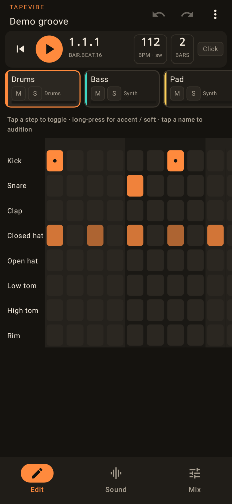
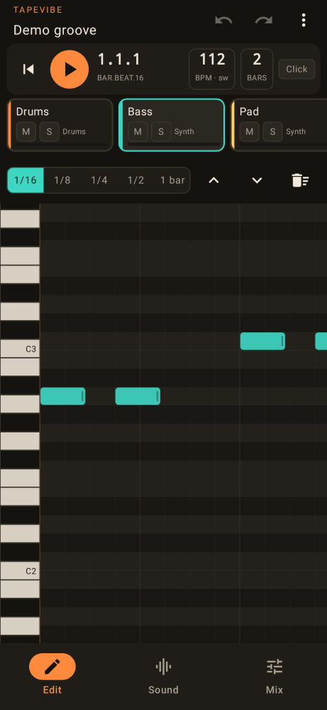
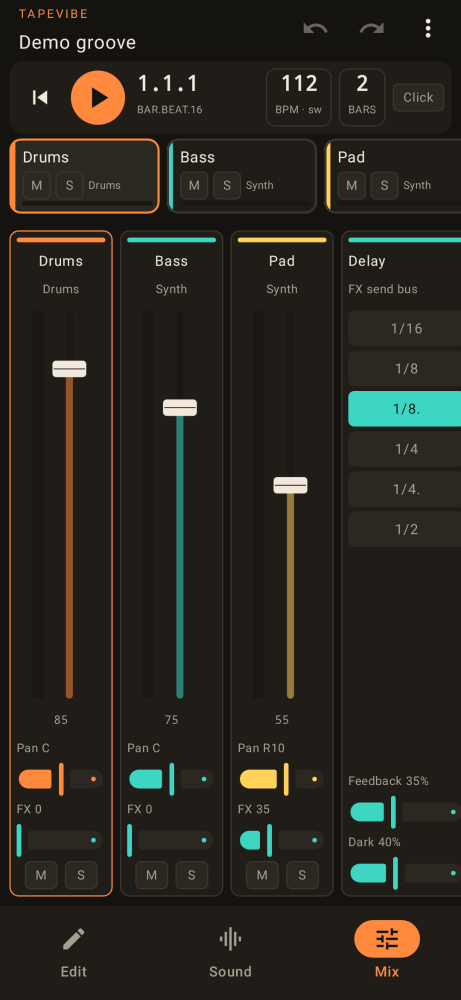

# Tapevibe

A loop-based DAW for Android: drum machine, polyphonic synths, a sampler and
microphone-recorded audio tracks, all running on a low-latency native audio engine.

<p>
  
  
  
</p>

## Features

- **Up to 16 tracks**, four kinds:
  - **Drums**: 8 synthesised pieces (kick, snare, clap, closed and open hats, two toms, rim) on a step grid with accents.
  - **Synth**: 8-voice two-oscillator subtractive synth (PolyBLEP saw and square, triangle, sine) with a resonant filter, filter envelope, amp ADSR, an LFO and presets.
  - **Sampler**: plays an imported WAV chromatically from the piano roll.
  - **Audio**: records one loop pass from the microphone, or uses an imported WAV, played back in sync with the loop.
- **Loop sequencer**: 1, 2, 4 or 8 bars, 40 to 240 BPM, swing, a metronome and tap tempo. Lengthening the loop repeats what's already there.
- **Piano roll**: tap to add or delete a note. Long-press a note and drag to move it, or drag from its right end to resize. Also octave transpose and an audition keyboard.
- **Mixer**: volume, pan, mute, solo, a send to a tempo-synced ping-pong delay, peak meters and a soft-clipping master.
- **Undo and redo** for every edit. A slider drag counts as one undo step.
- **Projects** autosave and can be opened, duplicated and deleted.
- **WAV export**: an offline bounce of N loop repeats plus a tail, saved anywhere through the system file picker.

## Architecture

```
app/src/main/cpp/
  core/            Platform-independent engine (no Android deps, unit-tested on host)
    Engine.*       Transport, sequencer, mixer, delay, recording, offline bounce
    SubSynth.cpp   DrumKit.cpp   Sampler.cpp   Wav.cpp
  android/
    AudioIO.*      Oboe output/input streams (low-latency, auto-reopen on device change)
    jni_bridge.cpp JNI surface used by com.tapevibe.audio.NativeBridge
  tests/           Host tests (timing, mute/solo, sampler pitch, recording, GC, export)
app/src/main/java/com/tapevibe/
  model/           Project/Track/Note, instrument parameter layout, pure edit ops, undo history
  audio/           AudioEngine interface, JNI wrapper, EngineSync (diffs model -> engine)
  data/            JSON project store
  ui/              Compose UI and DawViewModel
```

The **audio thread never locks or allocates**. Scalar settings are atomics. Note
lists and sample buffers are published by swapping an atomic pointer. Old objects
are freed on the control thread only after the audio callback has completed two
cycles past the swap. Preview notes go through a lock-free SPSC queue, and so does
microphone input on its way to the recorder.

The UI never talks to the engine directly. `DawViewModel` holds an immutable
`Project`, and `EngineSync` pushes only the fields that changed, on a dedicated
engine-control thread.

## Building

Requirements: JDK 17+, Android SDK with platform 36, NDK `27.2.12479018`, CMake `3.22.1`.

```sh
./gradlew assembleDebug          # APK in app/build/outputs/apk/debug/
./gradlew testDebugUnitTest      # JVM tests (model, sync, ViewModel, storage)

# Native engine tests on the host (Linux/macOS), with sanitizers:
cmake -S app/src/main/cpp -B build/native -DCMAKE_CXX_FLAGS="-fsanitize=address,undefined -g"
cmake --build build/native && ./build/native/engine_tests
```

`assembleRelease` is signed with the debug key so it installs. Set up a real
signing config before you distribute it.

## Known limitations

- Recording isn't latency-compensated, so takes land a few milliseconds late, depending on the device.
- Audio clips don't time-stretch. They play from the loop start at their recorded speed.
- Sample import is WAV only (PCM 8, 16, 24 or 32-bit, or 32-bit float).
- There's no song/arrangement mode yet. A project is a single loop.
- No background playback: audio stops when the app leaves the foreground.
